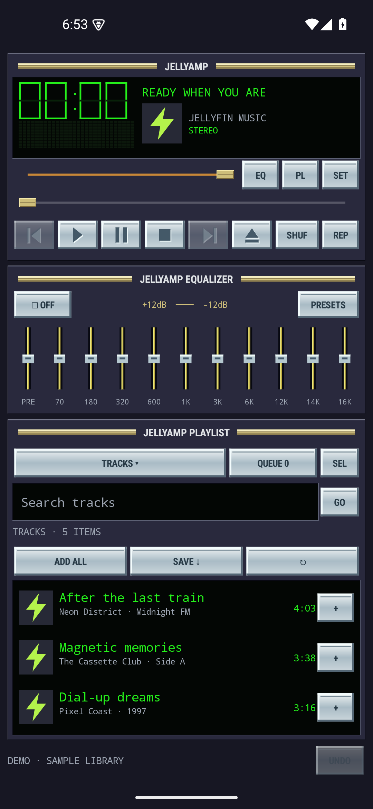
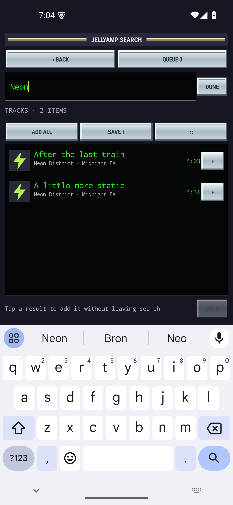

# Jellyamp

**Queue a vibe. A classic Winamp-inspired Jellyfin music player for Android.**

Jellyamp makes it quick to turn your own music collection into the soundtrack for a party,
a road trip, or whatever mood you are putting together. Tap a track to start listening,
then keep tapping to build the queue without replacing the song that is playing. Search,
add a bunch of tracks, and save the whole queue as a Jellyfin playlist for next time.

**This project was vibe coded with AI assistance. Contributions are very welcome.**
Bug fixes, better party and playlist workflows, accessibility improvements, testing on real
phones and Android Auto, and thoughtful UI polish all help. See [Contributing](CONTRIBUTING.md).

- Fast, queue-first browsing: additions keep the music going.
- An easy queue and playlist builder for parties and putting together a quick vibe.
- Track-title and artist search that updates as you type, plus infinite scrolling.
- A native classic-player skin, real ten-band EQ, and a spectrum that moves with the music.
- Gapless playback, optional crossfade, offline downloads, and Android Auto browsing.
- MIT licensed. Bring your own Jellyfin server and account. Android 8.0 or newer.

<p>
  
  
</p>

Independent app; unaffiliated with Winamp or Jellyfin. The interface is drawn natively;
no original Winamp skin images are bundled. Demo mode uses fictional titles.

## Install

Get the APK from [GitHub Releases](https://github.com/rknell/jellyamp/releases/latest),
install it, and sign in to your Jellyfin server. Use HTTPS outside a trusted home network.
Server base paths are supported. You can explore Demo mode before connecting.

The current published build is **0.3.6** and is debug signed. It uses the same signing key
as the earlier personal builds, so it can update those installations while retaining sign-in
and saved app data. Building on another machine normally uses a different debug key, so that
APK may require uninstalling an existing installation first. Uninstalling removes phone-only
music downloads and saved app data; server playlists remain on Jellyfin.

To make a quick mix: tap tracks to queue them, open **Queue** to reorder or remove entries,
and use **Save As** to keep the mix as a private Jellyfin playlist. Clearing the queue is an
explicit action in the Queue view, so browsing for the next song does not wipe your mix.

## Build your queue

- **Tap a library track to append it immediately.** The first entry starts playing;
  subsequent taps keep the current song and position. Adding to a paused queue leaves it paused.
- **ADD ALL** appends the loaded tracks, album or playlist. The entire library is reachable
  through seamless infinite scrolling: the next 100 items are prefetched as you approach the
  bottom, with no Load More button. Only visible rows are drawn, so large libraries stay light.
  Search results use the same automatic loading. Playlist entries load in full.
- **Tap the green time display** to switch between elapsed and remaining time. Remaining
  time has a minus sign; the choice is remembered across app restarts. Unknown durations
  display `--:--` in remaining mode until the duration becomes available.
- **Previous/Next** are dimmed and disabled when there is no track in that direction, including
  empty and single-track queues. Shuffle uses its actual play order; Repeat All permits wrapping.
  Previous skips to the previous track when available.
- **QUEUE** is always accessible. Tap a queue entry to jump to it. Hold its **≡** handle
  and drag it onto another entry to reorder. **+** also offers play next, play now while
  retaining the queue, and move/remove actions.
- **CLEAR QUEUE** exists only in Queue. Clear/removals have **UNDO**. Undo reinserts the
  removed entries and retains tracks you have added since the removal.
- The queue, current index, playback position, shuffle/repeat and volume are saved in
  account-scoped private storage. Reopening restores it paused, so audio never starts
  unexpectedly. Position is checkpointed approximately every three seconds and on changes.
- **SAVE AS** saves the queue as a private Jellyfin playlist.

## Library, artwork and playlists

The library dropdown switches between Tracks, Albums, Artists, Playlists, Favourites,
Offline and History. **Tracks** is a flat list sorted by track title. **Artists** shows the
same tracks in a flat list sorted by artist, then track title; tap any track to queue it,
with no artist/album navigation. **Albums** is sorted by album artist, then album name;
open an album to see its tracks in disc/track order. Sorting happens on the server before
paging, so the order stays consistent throughout infinite scrolling. Android Auto uses
the same browsing order.

**Back remembers your place.** Opening an album, playlist or nested library view saves its
parent list and exact scroll offset. Each Back step returns to that location, including
pages reached through infinite scrolling. Returning from search also restores the list
immediately. Android Back and **‹ BACK** behave the same way. Navigation positions survive
screen recreation; lists reload only when needed, including after playlist edits.
Artwork appears in the list and player and is cached for offline use and media notifications.
Missing covers use a small placeholder.

Create private playlists, rename them, duplicate them, add multiple tracks, drag to reorder,
and remove entries with undo. Hold a track or tap **SEL** for multi-selection. Bulk actions
include queueing, adding to a playlist, downloading and removing queue/playlist entries.
Edits sync immediately and use the Jellyfin user's existing permissions. Exact playlist-entry
IDs distinguish entries; Jellyfin versions that deduplicate additions retain that behavior.
Media files are never deleted by playlist actions. Whole playlist deletion remains in Jellyfin.

## Search that stays visible

Tap the search field or **GO** to open a dedicated search screen. Its input stays at the top,
above the keyboard, with results in the scrollable area below. Results update after a short
300 ms pause in typing; no button press is needed. Search includes track titles and artist names,
including contributing artists. Title matches appear first, then tracks by matching artists,
without duplicate tracks. Both streams load in pages as you scroll. Tap several results to append them without closing the keyboard or interrupting
the current song. **DONE** or the keyboard's Search key dismisses the keyboard to expose more results.
**‹ BACK** returns to the previous library/playlist location; **QUEUE** opens the existing queue.

## Gapless playback and optional crossfading

Open **SET → Playback transitions**. The setting and crossfade duration persist on the phone:

- **Gapless — continuous albums** (default): Media3's continuous playlist playback, with no
  deliberate silence or overlap. Encoder delay/padding is trimmed when the file supplies the
  necessary information. Network buffering, silence already encoded in a file, or codec/device
  limitations can still produce a gap; downloaded tracks avoid network stalls.
- **Crossfade — overlap songs**: choose 1–12 seconds (default 5). The next item is preloaded and
  two audio players fade in/out with complementary gains. The session, queue and notification
  switch to the incoming track when the overlap begins. The on-screen volume and saved volume
  retain the user's setting. Crossfade is capped at half the outgoing track's length. Unknown
  durations, repeat-one, unavailable successors or songs that aren't ready in time fall back to
  normal playback. Manual seek/skip, queue edits, pause, focus loss and headphones disconnecting
  cancel the overlap so no old track continues playing behind the controls. Metadata/artwork
  updates retain the fade. The spectrum follows the incoming track during an overlap.
- **Separate tracks — short pause**: inserts a 250 ms pause at automatic track boundaries.

Gapless and crossfade are alternative transition modes: use gapless for live albums and other
continuous recordings, and crossfade for mixes. Crossfade requires decoding/buffering two tracks
briefly, increasing battery and network use while active. Its preloader/timer stops when paused
or when another transition mode is selected. Settings apply to the phone and Android Auto.
Physical device/output testing is recommended, especially Bluetooth and network streaming.

## Equalizer and spectrum

The EQ panel has ten peaking filters at 70, 180, 320, 600, 1K, 3K, 6K, 12K, 14K and 16K Hz,
plus preamp, on/off and Flat/Rock/Bass/Vocal/Electronic presets. Gains range from -12 to +12 dB.
Settings persist. Automatic headroom compensates for boosts, so increasing a band may reduce
other frequencies' volume. Extreme preamp settings can still saturate; samples are bounded.

The spectrum analyses decoded PCM after equalization and animates with peak decay. It reacts
to streamed and downloaded music. Animation runs only while the player is actually playing;
pausing, stopping, buffering, playback suppression or an empty queue clears the bars immediately
and cancels animation frames. Hidden/detached views also stop scheduling frames. It resumes
with playback. It does **not** record
microphone audio and requests no recording permission. EQ/spectrum use a PCM path, which
can consume more battery than hardware-offloaded playback. EQ can be collapsed with **EQ**.

## Offline music

Open an album/playlist and tap **SAVE ↓**, use a track's **+ → Download**, or select several
tracks. Downloads use the original files permitted by your Jellyfin user's download policy.
Two files download concurrently, with progress and failure/retry status in **Offline** and an
Android notification. **SET** pauses/resumes downloads. Failed files can be retried from **+**.
Android may ask for notification permission; files stay in private app storage.

Completed downloads are preferred automatically. Queued remote entries are upgraded as their
downloads complete; loss of a network or a streaming failure switches to a completed local copy
when one is available. Cached library/playlist screens remain browsable when requests fail.
**Offline** lists downloaded and pending tracks; only completed files can play without a network.
A previously opened/downloaded playlist can also be opened through the cached Playlists browser.

**Remove download from phone** asks for confirmation and removes only the app's downloaded
copy. Server media stays untouched. Signing out stops playback and downloads and keeps saved
queues/downloads private to that server/account. Android app uninstall or clearing app storage
removes its local music. Server-side playlist edits are not automatically mirrored into an
existing offline download selection: download again to add new entries, and remove unwanted
local copies explicitly.

## Favourites and listening history

Use a track's **+** menu to toggle its Jellyfin favourite. Changes are queued locally when
necessary and retried against Jellyfin. Playback start/progress/stop events are sent from the
service, including when the screen is closed. An account-scoped durable outbox retries network
failures, including offline listening, when connected again. **SET → Sync favourites and play
history** triggers another attempt. Jellyfin decides when a title qualifies as played; the
History browser shows Jellyfin's played tracks, ordered by date played. Offline events sync to
the current Jellyfin session when connectivity returns, so historical display times may reflect
sync time. Pending sync work needs the app/service to run; it is not a separate periodic job.

## Android Auto

The exported MediaLibraryService exposes Tracks, Albums, Artists, Playlists, Favourites and
Downloaded music to Android Auto, along with search, voice selection, artwork and normal
transport controls. Sign in on the phone first. Car selections append to the existing queue
and start the selected entry. Browsing only accepts the app's own UID or trusted system/media
controllers, and externally supplied media IDs are resolved through the signed-in Jellyfin
account rather than accepting arbitrary stream URLs.

For a sideloaded build, Android Auto may hide the app until its **Unknown sources** developer
option is enabled. Open Android Auto settings, tap the version/permission section ten times
to enable developer mode, then use Developer settings in the overflow menu. See the
[official Android Auto testing instructions](https://developer.android.com/training/cars/testing#unknown-sources).
A physical car/head-unit test is still needed; development verification exercises Android's
legacy car media browser and voice transport interface on an emulator.

## Privacy and authentication

The session is AES-GCM encrypted with an Android Keystore key. Passwords are not persisted.
Authentication travels in headers, never in stored stream URLs or image URLs. Android backups
are disabled. Queues, metadata, history outboxes, artwork and downloads live in app-private,
server/user-scoped storage; credentials are not bundled with the APK. Signing out clears the
local session and attempts server revocation; if offline, revoke the device in Jellyfin if needed.
No personal library, server credentials or runtime state belong in source or release outputs.

## Build and tests

Use JDK 17 and an Android SDK containing platform/build tools 35, with `ANDROID_HOME` set or
an untracked `local.properties` defining `sdk.dir`. Gradle 8.14, AGP 8.11.1 and Media3 1.8.0
are pinned. Core library desugaring supports Java APIs on older Android versions.

```sh
./gradlew assembleDebug lintDebug
# app/build/outputs/apk/debug/app-debug.apk
```

With an Android emulator running, Docker, ffmpeg and Python 3 available:

```sh
./scripts/integration-test.sh
```

The script creates an isolated Jellyfin 10.11 on loopback port 18096 with two generated tones
and a synthetic album cover, and removes only its own test container on exit. It leaves its
printed temporary test directory for inspection. No production mounts, credentials or media
are used. Tests must never target the live server.

The instrumentation suite covers queue appends through the UI, clear/undo, queue restoration,
FLAC/MP3 and server transcoding, background playback, downloads read with no network source,
artwork, actual EQ frequency response and PCM spectrum data, favourite/history sync, playlist
undo/duplication, encrypted sessions, URL validation and car browsing/voice queue selection.
Additional checks verify search remains visible above a real software keyboard, queue additions
from live search, artist-name matches with different track titles, debounced typing and
deduplicated title/artist pagination, crossfade handoff/gains/volume persistence and pausing both players, metadata
updates during a fade, gapless boundaries and the optional separate-track pause. A synthetic
225-track HTTP fixture checks automatic page loading, bounded visible rows, connection retry,
ordering without duplicates and restoring a deep scroll position after search. Transport checks
cover queue edges, clearing, shuffle, Repeat All and skipping back from a later track.
A deep album-navigation check verifies exact row/pixel restoration through search and both
Back controls, with saved pages reused instead of fetched again. A rendered-title check
verifies that a long title reaches its final characters and loops while playback updates run.

This is a debug-signed personal build. Store publishing, casting, selectable skins and a compact
mode are not included. Phone and physical-head-unit testing complement the Android 15 emulator
checks; no claims of Play Store or Android Auto certification are made.


## Contributing

This is an actively evolving, vibe-coded personal project, and contributions are welcome.
Open an issue with a reproducible problem or a feature idea, or send a focused pull request.
[CONTRIBUTING.md](CONTRIBUTING.md) covers local builds, safe test fixtures and useful ways to help.
Do not include your Jellyfin password, tokens, private server address or personal library data
in an issue, screenshot or test fixture.

## License

Original Jellyamp code is available under the [MIT License](LICENSE).
Third-party libraries and the Gradle wrapper retain their own licences; see
[Third-party notices](THIRD_PARTY_NOTICES.md).
